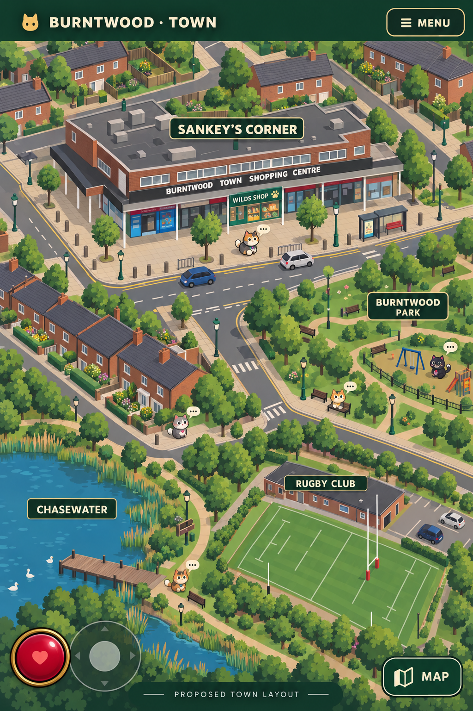

# Approved town overhaul direction — 16 October 2026

Status: visual direction approved by Stef; design record only, NOT implementation/release authorization. Gameplay/release ownership stays with the other Work chat.

Stef approved the second concept: “Yes!! Keeps the feel of Burntwood but also makes it more enjoyable in game.” He then requested this repository record.

## Locked direction
- Recognisable Sankey's Corner / Burntwood Town Shopping Centre anchors the hub.
- Use the supplied real shopping-centre photo as architectural reference: long two-storey red-brown brick block, flat roof, narrow upper windows, black fascia/white lettering, covered shop walkway on slim posts, coloured glazed shopfronts, green streetlamps, paving, bollards and road details.
- Match the existing game's visual language; simplify the illustrated reference into readable Canvas/layered 2D forms. Preserve approved heroes, proportions, floating paws and all existing character assets. Generated concept cats are not replacements.
- Compress distances/proportions for enjoyable exploration. Preserve these user-directed relationships with north up:

| Destination | Relative to Sankey's Corner |
| --- | --- |
| Chasewater | Southwest |
| Rugby Club | South, just right/east of Chasewater |
| Burntwood Park | East |

- Connected streets, pavements, crossings, residential areas and green routes should form an inviting explorable town.
- Do not silently equate Burntwood Park with the existing Chase Terrace Park arena. Resolve the intended relationship before implementation.
- First ornate old-fashioned market-village concept was rejected: too quaint, insufficiently Burntwood and too far from existing game design. Do not revive it.
- The approved image is a direction reference, not exact geography, a finished playable map, or approval of every invented prop, shop, HUD detail and interaction.
- No town code, production assets, balance, version, build, CI or release-status changes were made by this audit.

## Reference integrity
Exact approved generated PNG: 1024×1536, 2,482,369 bytes.
SHA256: 0d050474094b1aaadf104645710a8bebcdb4362d8892cda6c401486d3f6ba229
Git blob: 0dd852b80deb1bf98a6306cad1b85b5fae4978d9
Original user architectural photo was visible in the conversation (IMG_1672.jpeg), but is not included in this record; do not claim it is committed.

## Next action
Review this design and current repository state with the release owner after its active update. Obtain explicit town-update instruction before implementation. Audit chats remain review-only except authorised documentation.
